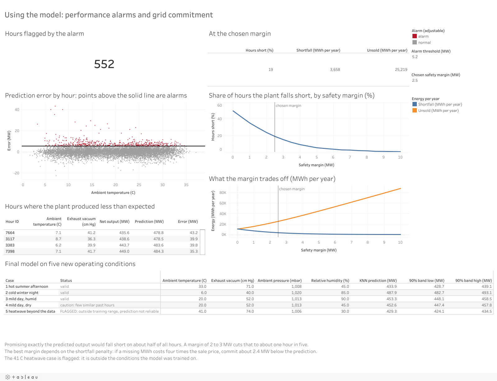
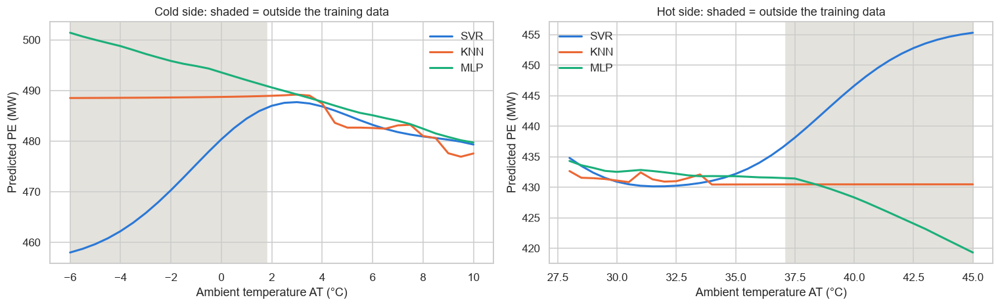

# Predicting the power output of a combined cycle power plant

This project predicts the hourly net electrical output (MW) of a combined cycle power plant running at full load. The inputs are four measurements: ambient temperature, exhaust vacuum, ambient pressure and relative humidity. It uses 9,568 hours of real plant data from the UCI Machine Learning Repository and compares three machine learning models. The best model then drives two plant decisions, a performance alarm and a safety margin for grid commitments, both shown in an interactive Tableau Public dashboard.



Live dashboard on Tableau Public:
[Plant operations](https://public.tableau.com/app/profile/shaikh.muhammad.zain/viz/CCPPfull-loadpowerpredictionoperationsmodelsanddecisions/Plantoperations),
[Model performance](https://public.tableau.com/app/profile/shaikh.muhammad.zain/viz/CCPPfull-loadpowerpredictionoperationsmodelsanddecisions/Modelperformance),
[Decision support](https://public.tableau.com/app/profile/shaikh.muhammad.zain/viz/CCPPfull-loadpowerpredictionoperationsmodelsanddecisions/Decisionsupport).

## Results

Test set of 1,906 hours that no model saw during training or tuning:

| Model | RMSE (MW) | MAE (MW) | MAPE (%) | R² |
|---|---:|---:|---:|---:|
| KNN regression (selected) | 3.449 | 2.444 | 0.540 | 0.959 |
| SVR, RBF kernel | 3.613 | 2.643 | 0.584 | 0.955 |
| MLP neural network | 3.659 | 2.737 | 0.604 | 0.954 |
| Mean baseline | 17.055 | 14.826 | 3.255 | 0.000 |
| Santarisi & Faouri (2021), best model | n/a | n/a | 0.872 | 0.912 |

All three models beat the best published result on this dataset. The published study used a different split, so the comparison is indicative.

## What the project does

- Data audit. The raw data has 41 duplicate rows, 55 humidity readings above 100%, and 182 hours where the exhaust vacuum is higher than the ambient pressure, so its cm Hg label cannot be right. The five sheets of the Excel file are shuffled copies of the same rows. Duplicates were removed and humidity was capped at 100%. Outliers are real weather, so they were kept. 9,527 hours remain.
- Exploratory analysis. Output falls by about 2.2 MW per °C, mostly because hot air is less dense. Humidity looks positive in a plain correlation and turns negative once temperature is held fixed. The apparent effect of pressure mostly comes from its link with temperature. The condenser penalty behaves like a threshold and is strongest between 15 and 30 °C.
- Leakage control. The 80/20 split is stratified on output (seed 42), scaling is fitted inside a scikit-learn pipeline, hyperparameters are tuned by 5-fold cross-validation on the training set, and the test set is used once.
- Models. SVR (C = 30, γ = 2, ε = 2 MW), KNN (k = 6, distance-weighted, Manhattan distance) and an MLP (128-128-64, standardized target, early stopping).
- Model selection beyond accuracy. A paired bootstrap shows the KNN lead is statistically significant. KNN over-predicts by more than 5 MW on 5.3% of hours, against 6.9% (SVR) and 7.8% (MLP). Other checks cover sensor noise, behaviour outside the training range, a day-ahead model without the vacuum input, and cost.
- Extrapolation check. At 45 °C, hotter than any hour in the data, the SVR predicts 455 MW, about a mild day's output. The deployed KNN therefore flags any hour outside the training range, and also flags inputs with few similar past hours.
- Interpretation. Permutation importance and accumulated local effects (ALE) agree with the thermodynamics. Across each input's range, output changes by about 54 MW for temperature, 10 MW for vacuum, 7 MW for humidity and 3 MW for pressure.
- Decisions. The alarm threshold (5.2 MW below prediction) comes from the test errors. The safety margin follows the newsvendor rule: 2.4 MW when a shortfall costs four times the sale price.



## Repository layout

- `01_Dataset/raw`: the original UCI file `Folds5x2_pp.xlsx` and an unchanged CSV copy of Sheet1.
- `01_Dataset/cleaned`: the cleaned data and a row-by-row log of every change.
- `02_Notebook`: `CCPP_Power_Prediction.ipynb`, the full analysis in 13 sections, saved with all outputs. `outputs/` holds the 25 figures and every CSV the notebook writes.
- `03_Dashboard`: the Tableau workbook (`CCPP_dashboard.twbx`), the seven CSV files it reads, five screenshots and a narrated 2:49 walkthrough video.
- `04_Report`: the technical report (PDF, 35 pages).
- `05_Presentation_and_Poster`: the slides (15) and an A1 poster, as PDF.

## How to run

In Google Colab: open `02_Notebook/CCPP_Power_Prediction.ipynb`, choose Runtime > Run all, and upload `01_Dataset/raw/Folds5x2_pp.xlsx` when the upload button appears. A full run takes about 30 to 40 minutes on free Colab.

Locally:

```
pip install -r requirements.txt
cd 02_Notebook
jupyter nbconvert --to notebook --execute --inplace CCPP_Power_Prediction.ipynb
```

Run it from inside `02_Notebook`. It finds the data in `../01_Dataset/raw` and writes to `outputs/`. A full run takes about 10 minutes on an 8-core laptop. Every random step uses seed 42. A Colab run (Python 3.13, scikit-learn 1.6.1) reproduced the local results (Python 3.14, scikit-learn 1.9) exactly. Only the timings differed.

## Data and references

- Tüfekci, P., & Kaya, H. Combined Cycle Power Plant [Dataset]. UCI Machine Learning Repository. https://archive.ics.uci.edu/dataset/294/combined+cycle+power+plant. License: CC BY 4.0.
- Tüfekci, P. (2014). Prediction of full load electrical power output of a base load operated combined cycle power plant using machine learning methods. International Journal of Electrical Power & Energy Systems, 60, 126-140. https://doi.org/10.1016/j.ijepes.2014.02.027
- Santarisi, N. S., & Faouri, S. S. (2021). Prediction of combined cycle power plant electrical output power using machine learning regression algorithms. Eastern-European Journal of Enterprise Technologies, 6(8(114)), 16-26. https://doi.org/10.15587/1729-4061.2021.245663

## License

Code and documents: MIT, see `LICENSE`. The dataset in `01_Dataset` belongs to Tüfekci and Kaya and is shared under CC BY 4.0.
